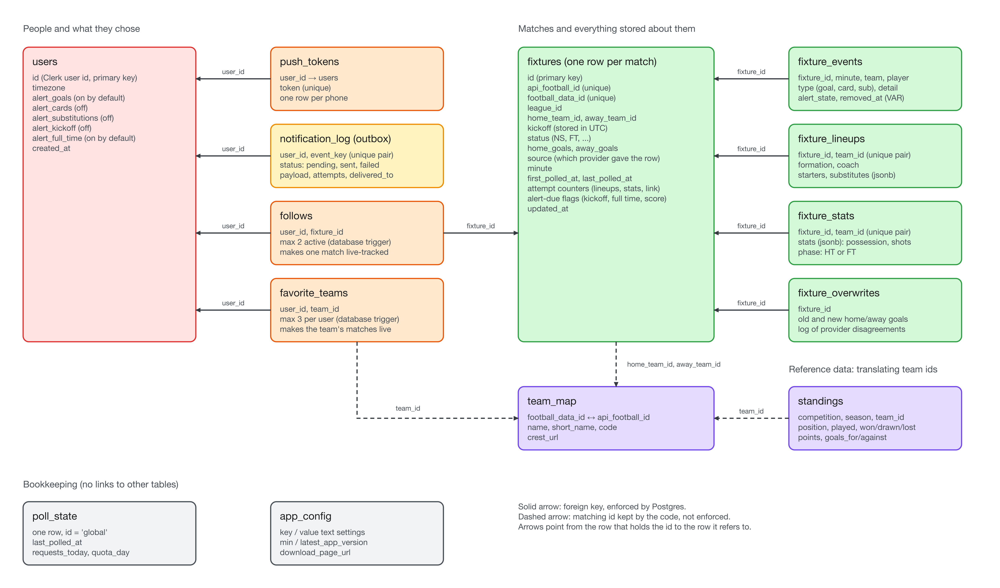

# Diagram 1: the database

Editable source: [01-database.excalidraw](01-database.excalidraw) (open it in the Excalidraw VS Code extension or at excalidraw.com). The tables are defined in [schema.ts](../../server/src/db/schema.ts); the numbered SQL files in `server/drizzle/` are the migrations that built them.

## 1. What is a database here, in plain words

ScorePulse needs to remember things: who signed in, which teams they like, what the score of a match is, which alerts were already sent. It keeps all of this in a **database**, which you can think of as a set of spreadsheets that the server can read and change very fast and very safely.

- Each spreadsheet is a **table** (for example `fixtures`).
- Each row of a table is one **record** (one match).
- Each column is one **field** (the kickoff time, the score).

The database is **Postgres**, hosted by a service called **Neon**. The server code does not write raw SQL most of the time; it uses **Drizzle**, a library (an **ORM**, "object-relational mapper") that lets TypeScript describe the tables and generates the SQL.

## 2. Words you need to read the diagram

| Word | Meaning | Example in this project |
| --- | --- | --- |
| **Primary key (PK)** | The field that identifies a row uniquely. No two rows share it. | `users.id` is the user's Clerk id. `fixtures.id` is a counter (`serial`) that goes 1, 2, 3 ... |
| **Foreign key (FK)** | A field that holds another table's primary key, so a row can point at a row elsewhere. The database refuses a pointer to a row that does not exist. | `follows.user_id` points at `users.id`. In the diagram this is an arrow. |
| **Cascade delete** | When the row pointed at is deleted, the rows pointing at it are deleted too. | Delete a user and their favorites, follows, push tokens and notification log vanish with them. Delete a fixture and its events, lineups and stats go too. |
| **Unique constraint** | A rule that no two rows may have the same value (or the same combination of values). | `push_tokens.token`, and the pair (`user_id`, `team_id`) in `favorite_teams`. |
| **Nullable** | A field that may be empty (`NULL`) because the value is not known yet. | `home_goals` is empty before the match starts. |
| **jsonb** | A field that stores a small JSON document instead of a plain value. | A team's list of starting players in `fixture_lineups`. |
| **Trigger** | A rule that runs inside the database whenever a row is inserted or changed, and can refuse it. | The cap of 3 favorites per user. |
| **Migration** | A numbered SQL file that changes the database from one shape to the next. They run in order and are never edited afterwards. | `0009_favorites_cap_trigger.sql`. There are 22 (0000 to 0021). |
| **Outbox** | A table where "things I owe someone" are written first and sent later, so a crash cannot lose them. | `notification_log`. |
| **Idempotent** | Safe to do twice: the second time changes nothing. | Writing the same alert row twice is blocked by a unique key. |

## 3. How to read the colours

The boxes are coloured by job, not by anything the database knows:

- **Red** (`users`): the person. Almost everything about a person points at this table.
- **Orange**: what a person has chosen or owns (`favorite_teams`, `follows`, `push_tokens`).
- **Yellow** (`notification_log`): the outbox of alerts to send.
- **Green**: everything about matches: the `fixtures` table in the centre, and four tables hanging off it.
- **Purple**: reference data that translates or lists teams (`team_map`, `standings`).
- **Gray**: bookkeeping for the system itself (`poll_state`, `app_config`).

Arrows point from the table that holds an id to the table that id refers to, and the label on each arrow is the column that holds it. A **solid** arrow is a real foreign key the database enforces. A **dashed** arrow is a link kept by convention only: the value matches a team id, but Postgres does not check it. That is deliberate, because a team id comes from an outside provider and the code, not the database, is responsible for keeping it valid.

The two big boxes (`users` and `fixtures`) are tall on purpose: they are the two things everything else hangs off, so they list most of their columns. The small boxes list only the columns that explain what the table is for.

## 4. The tables, one by one

### Who uses the app

**`users`**: one row per signed-in person. The id is the id **Clerk** gives them (Clerk is the sign-in service; ids look like `user_2Rf...`). The row is created on first sign-in. It stores the person's timezone (times are saved in UTC and shown in this zone) and five alert switches: goals and full time are on by default, cards, substitutions and kickoff are off. The row is removed when the account is deleted: either the app calls `DELETE /me`, or Clerk sends a `user.deleted` webhook (a message from Clerk to the server) that the server checks with [webhook.ts](../../server/src/webhook.ts).

**`favorite_teams`**: a team a person favours. **A favorite makes every match of that team live-tracked**, which means the poller watches it closely. The maximum is **3** per person ([ADR 0014](../adr/0014-cap-favorites-at-three-and-active-follows-at-two.md)).

**`follows`**: a person follows **one specific match**, which also makes that match live-tracked. The maximum is **2 active** follows ("active" means the match is not over). A follow with a finished match no longer counts.

**`push_tokens`**: one row per phone. A **push token** is an address Expo (the push service) gives a device so the server can send it a notification. A person with two phones has two rows and gets every alert on both ([ADR 0008](../adr/0008-push-recipient-rules.md)). The token is unique: if a phone signs in as someone else, its row moves to that account.

**`notification_log`**: the **outbox**. Before an alert is sent, one row per person and event is written with status `pending`. Sending then moves it to `sent`, `failed` (it gave up after the retry cap) or `skipped` (the person stopped being a recipient or has no device). Fields to know:

- `event_key`: a text id for the event, like `fixture:42:event:7`. A correction adds `:removed`.
- `payload`: the alert's text content, saved with the row so sending needs no extra lookup.
- `attempts`: failed sends so far.
- `delivered_to`: the tokens that already received it, so a retry never sends to the same phone twice.
- The unique pair (`user_id`, `event_key`) means the same alert cannot be queued twice for a person.

### Matches

**`fixtures`**: the centre of the app. One row per match: when it kicks off, its status (`NS` not started, `FT` full time, and so on, using API-Football's short codes), the goals, and `source`, which records which data provider supplied the row ([ADR 0003](../adr/0003-provider-conflict-resolution.md)). It has two optional ids, one per provider, because the app uses two (see the next section): `api_football_id` and `football_data_id`.

It also has several fields that are not about the match itself but about the **poller's bookkeeping**:

- `first_polled_at`: set on a match's first poll, so events that already existed then count as history, not news ([ADR 0002](../adr/0002-follow-backfill.md)).
- `last_polled_at`: the last poll that covered the match, even a quiet one.
- `lineups_attempts`, `stats_ht_attempts`, `stats_ft_attempts`, `link_attempts`, `completion_attempts`: how many times it asked for something that came back empty, so it does not ask forever (requests are limited to 100 a day).
- `kickoff_alert_due`, `full_time_alert_due`, `score_alert_due`, `uncovered_goals`: "an alert is owed" flags. They are written in the same statement as the new status or score, so a crash cannot lose the alert.

**`fixture_events`**: one row per thing that happened in a match (goal, card, substitution). The API gives events no id of their own, so an event is identified by a combination of fields (a **composite unique key**: fixture, minute, extra time, team, player, type, detail). Two details worth knowing:

- That unique key uses `NULLS NOT DISTINCT`. Normally Postgres treats two empty values as different, which would store the same event twice. This setting makes empty equal empty.
- A goal can be cancelled by VAR (video review). The row is not deleted: `removed_at` is set so the timeline can still show it struck through ([ADR 0009](../adr/0009-var-correction.md)). `missing_polls` counts polls where the goal vanished from the provider's answer; two in a row also cancels it.
- `alert_state` is `none`, `due` or `issued`, so the code knows whether an alert for this goal still has to be written. `correction_due` says a correction ("that goal was cancelled") is owed.

**`fixture_lineups`**: each team's starting players and substitutes, stored as jsonb. Fetched once before kickoff. Substitutions during the match are not stored here; they are applied when reading, using `fixture_events`.

**`fixture_stats`**: each team's match statistics as numbers (possession, shots and so on). `phase` is `HT` (halftime) or `FT` (full time); the full-time fetch overwrites the halftime numbers.

**`fixture_overwrites`**: a log. A nightly job sometimes replaces a live-tracked match's result with the other provider's. Each time, the old and new scores are saved here, so you can measure how often the two providers disagree.

### Reference data

**`team_map`**: a translation table between the two providers' team ids. Each row says "this team is id 111 at football-data.org and id 222 at API-Football" (made-up numbers), plus a name, short name, three-letter code and crest URL for the team picker. It exists because live events carry API-Football ids, so fixtures store those, while the nightly snapshot arrives with football-data.org ids and is translated through this table.

**`standings`**: one league-table row per team, copied from football-data.org (so its `team_id` is a football-data.org id, not an API-Football one). It is identified by competition code (`PL`, `PD`, `FL1`, `BL1`, `CL`), season year and team.

### System bookkeeping

**`poll_state`**: **one row** with the id `global`. It records when the poller last ran and how many API-Football requests were spent today. This is how the poller keeps within the 100-a-day limit ([ADR 0016](../adr/0016-poll-schedule-and-request-budget.md)) and exits early when there is nothing to do ([ADR 0010](../adr/0010-poller-early-exit.md)).

**`app_config`**: simple key and value settings the owner edits straight in the Neon dashboard, with no admin screen: `min_app_version`, `latest_app_version` and `download_page_url`. The app reads them at launch, before sign-in, to decide whether it must be updated ([ADR 0007](../adr/0007-update-gating.md)).

## 5. Why two providers?

The app takes data from two services, and the schema shows it:

| Provider | Gives | Used for | Id in the schema |
| --- | --- | --- | --- |
| **API-Football** | Live scores, events, lineups, statistics | The live poller | `api_football_id` |
| **football-data.org** | The fixture list, standings, a fallback score | The nightly snapshot, and the live fallback when API-Football's daily quota is spent ([ADR 0015](../adr/0015-fall-back-to-football-data-scores-when-quota-is-exhausted.md)) | `football_data_id` |

The free API-Football plan allows 100 requests a day, so the design is built around spending as few as possible. That is why so many tables carry "attempts" counters.

## 6. Rules enforced inside the database

Two limits are enforced by **triggers**, not just by the API ([migration 0009](../../server/drizzle/0009_favorites_cap_trigger.sql) and [0012](../../server/drizzle/0012_follows_max_active.sql)). The API also checks them (the numbers live in [limits.ts](../../server/src/limits.ts)), but the database is the lock that cannot be bypassed.

Why a trigger and not only a check in the API? Imagine a person taps "add favorite" twice at the same instant while they have 2. The API reads "2, so there is room" for both requests, and both insert, giving 4 favorites. A **race condition**. The trigger fixes it with an **advisory lock**: a lock keyed on the user id that makes one person's inserts happen one after another, so the second request sees the first one's row and is refused with the error `favorites_full`.

The trigger and the API must agree on the numbers. If you change the cap, change it in `limits.ts` and in a new migration, never by editing an old one.

## 7. Following one goal through the tables

1. The poller asks API-Football about live matches and updates the match's row in **`fixtures`** (the score).
2. It inserts a goal into **`fixture_events`** with `alert_state = 'due'`, in the same batch of statements.
3. A later step finds that goal, and for each person who favours that team or follows that match and has goal alerts on, writes a `pending` row in **`notification_log`**. It sets the event's `alert_state` to `issued`.
4. The sender reads the `pending` rows, looks up the person's **`push_tokens`**, sends through Expo, and sets each row to `sent`.
5. If VAR cancels the goal, `removed_at` and `correction_due` are set on the event row, and a correction alert follows the same path.

Because every step writes to the database first and acts second, a crash at any point means the next poller run finds the unfinished work and continues. This is the reason for the "due" and "issued" flags.

## 8. Things that are easy to get wrong

- **Two kinds of team id.** `fixtures` and the live tables use API-Football's ids; `standings` uses football-data.org's. Mixing them gives wrong teams with no error, because there is no foreign key to catch it. Translate through `team_map`.
- **Changing a column needs a migration.** Edit `schema.ts` and generate a new migration; do not edit the old ones, which have already run.
- **Times are UTC.** Convert using `users.timezone` only when displaying.
- **`updated_at` does not mean "recently checked".** It only changes when the score or status changes. Use `last_polled_at` to see how stale a match is.

Related: [code map](../CODEMAP.md), [glossary](../../GLOSSARY.md), [ADR index](../adr/INDEX.md), [the Worker CPU spike](../spikes/0002-worker-cpu-neon-and-fixtures-query.md)
