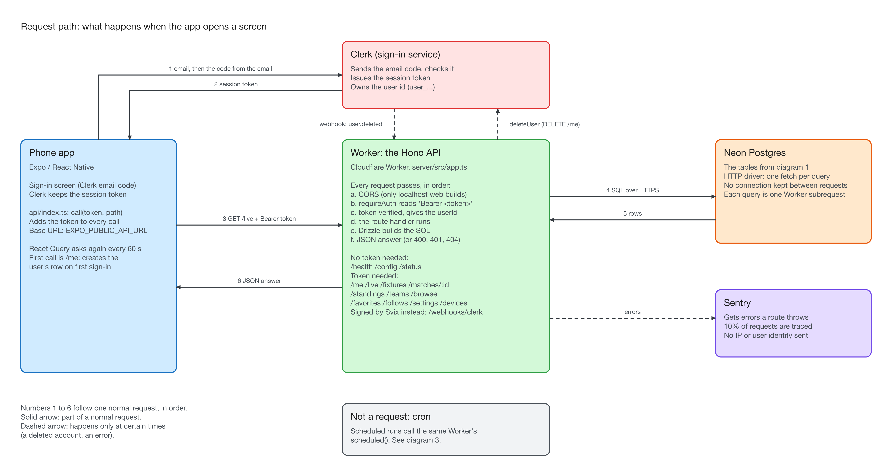

# Diagram 2: the request path

Editable source: [02-request-path.excalidraw](02-request-path.excalidraw). The routes are in [app.ts](../../server/src/app.ts), the Worker entry is [index.ts](../../server/src/index.ts), and the app's side is [api/index.ts](../../app/src/api/index.ts) and [api/hooks.ts](../../app/src/api/hooks.ts). Diagram 1 explains the tables behind the database box: [the database](01-database.md).

## 1. The idea in one paragraph

The phone app never talks to the database. It talks to a small program on the internet, the **Worker**, which checks who is asking, reads or writes the database on the app's behalf, and sends back the answer. A separate service, **Clerk**, handles signing in, so ScorePulse never stores a password. This split (app, API, database) is the most common shape for an app, and once you know it, most backend code makes sense.

## 2. Words you need

| Word | Meaning | Where you see it here |
| --- | --- | --- |
| **Client** | The program that asks. | The phone app. |
| **Server** | The program that answers. | The Worker. |
| **API** | The list of questions a server agrees to answer, and the shape of each answer. | Everything in `app.ts`. |
| **HTTP request** | One question over the internet: a **method** (`GET` read, `PUT` replace or add, `POST` send something, `DELETE` remove), a **path** (`/live`), and optional **headers** (extra labels such as `Authorization`). | Arrow 3. |
| **Route** or **endpoint** | One path plus method the server answers, for example `GET /live`. | `.get('/live', ...)` in `app.ts`. |
| **JSON** | A text format for data: `{"fixtures": [...]}`. Every answer here is JSON. | Arrow 6. |
| **Status code** | A number on every answer: `200` fine, `400` your request was wrong, `401` you are not signed in, `404` not found, `500` the server broke, `502` a service behind it failed. | The `(or 400, 401, 404)` in step f. |
| **Authentication** | Proving who you are. | Clerk and the token. |
| **Token (JWT)** | A long signed string that says "this is user X". The signature means nobody can forge one. It expires after a while. | Arrow 2 and the `Authorization` header. |
| **Bearer token** | The way a token is sent: the header `Authorization: Bearer <the token>`. Whoever bears it is treated as the user. | Arrow 3. |
| **Middleware** | A step every request passes through before the real handler, which can stop it early. | `requireAuth`, and the CORS step. |
| **CORS** | A browser rule: a web page may only call another website if that website allows it. A native phone app is not a web page and ignores it. | Step a. |
| **Serverless / Worker** | Code that runs on a provider's machines only when a request arrives, with no server of your own to look after. A Cloudflare **Worker** is that. | The green box. |
| **Hono** | A small web framework. It matches paths to handlers and gives you middleware. | `new Hono()` in `app.ts`. |
| **Drizzle** | The library that turns TypeScript into SQL (see diagram 1). | Step e. |
| **Webhook** | A message one service sends to your server when something happens on its side, instead of you asking. | Clerk telling the Worker a user was deleted. |
| **Secret / binding** | A value such as a key that the Worker is given when it runs and that is never in the code. They are listed in [env.ts](../../server/src/env.ts). | `CLERK_SECRET_KEY`, `DATABASE_URL`. |

## 3. Following one request (arrows 1 to 6)

### Signing in (arrows 1 and 2), once

1. In the sign-in screen the person types their email. The app asks **Clerk** to send a code to it (`signIn.emailCode.sendCode` in `sign-in.tsx`), then sends the code they type back (`verifyCode`).
2. If it is right, Clerk gives the app a **session token** and the app keeps it. The user's id is the id Clerk made, such as `user_2Rf...`. That same id is the primary key of `users` in the database.

The Worker is not involved in these two steps. ScorePulse's own server never sees an email code.

### Opening a screen (arrows 3 to 6), every time

3. The app calls the Worker, for example `GET /live`, adding the header `Authorization: Bearer <token>`. The helper is `call(token, path)` in `api/index.ts`. The base address comes from `EXPO_PUBLIC_API_URL` and falls back to `http://localhost:8787` (a Worker running on your own computer).

Inside the Worker, the request goes through the steps in the green box, in order:

- **a. CORS.** Only web pages served from `http://localhost:<port>` are allowed. The shipped phone app sends no origin, so this only matters when you try the app in a browser during development.
- **b. `requireAuth` reads the token.** No header means an immediate `401 Missing token`.
- **c. The token is verified.** The code calls `verifyToken` from Clerk's library with the Worker's `CLERK_SECRET_KEY`. If the token is fake or expired, the answer is `401 Invalid token`. If it is good, the token's `sub` field is the user id, and the code remembers it for the rest of this request. I did not check whether Clerk's library fetches signing keys from Clerk on each call.
- **d. The handler runs.** It checks its inputs first (a bad league code or a non-numeric id gives `400`, an unknown match gives `404`).
- **e. Drizzle builds the SQL and sends it to Neon (arrow 4).** The database does the work and returns the rows (arrow 5).
- **f. The answer goes back (arrow 6).** The handler shapes the rows into the form the app expects (`browse.ts` builds the `Fixture` and `Team` objects) and sends them as **JSON**.

The app then draws the screen. For lists of live matches, **React Query** (a library that remembers answers and refreshes them) asks again every 60 seconds (`refetchInterval: 60_000` in `hooks.ts`). That is as often as is useful, because the server's data itself changes at most once per poll, every 5 minutes.

## 4. Public routes and protected routes

Not every route needs a token:

| Kind | Routes | Why |
| --- | --- | --- |
| **Public** | `/health`, `/config`, `/status` | `/health` is an uptime check. `/config` is read at launch before anyone has signed in, to decide whether the app is too old to run ([ADR 0007](../adr/0007-update-gating.md)). `/status` says whether polling has slowed because the day's request quota is nearly spent. |
| **Needs a token** | `/me`, `/live`, `/fixtures`, `/matches/:id`, `/standings/:league`, `/teams`, `/browse`, `/leagues/:code/teams`, `/teams/:id/fixtures`, `/favorites`, `/follows`, `/settings`, `/devices` | These return data about matches or about the person. |
| **Signed, not tokened** | `/webhooks/clerk` | Called by Clerk, not by a signed-in person. See below. |

`GET /me` is the first call after signing in. It creates the person's row in `users` if there is none (`insert ... onConflictDoNothing`) and then reads it back. "Do nothing if it already exists" is what makes it safe to call every time: asking twice creates one row, not two. The comment in the code calls this the call that "proves the chain": app, Clerk token, Worker, Neon.

## 5. The dashed arrows: things that happen only sometimes

**Deleting an account (`DELETE /me`, the arrow into Clerk).** The Worker deletes the person's row in `users` first. Because of the cascade rules in diagram 1, their favorites, follows, push tokens and alert log disappear with it. Only then does it ask Clerk to delete the person. The order matters: if Clerk cannot be reached, the person's data is already gone from ScorePulse and a retry only has to finish Clerk's side. In that case the answer is `502 clerk_delete_failed`.

**A webhook from Clerk (`POST /webhooks/clerk`).** If a user is deleted some other way, for example by the owner in the Clerk dashboard, Clerk sends the Worker a message. The Worker cannot use a token here, because Clerk is not a person, so it checks a **signature** instead. Clerk signs its messages through a service called **Svix**: the signature is an HMAC (a hash made with a shared secret) of the message id, the timestamp and the body. The Worker recomputes it in [webhook.ts](../../server/src/webhook.ts) and refuses anything that does not match, or whose timestamp is more than 5 minutes off. A message that checks out and is a `user.deleted` event removes that user's row.

**Errors to Sentry.** **Sentry** is a service that collects error reports. Hono catches an error thrown inside a route and answers `500` by itself, so Sentry's own wrapper would never see it. For that reason `app.ts` has an `onError` handler that reports it. 10% of requests are traced for timing, and no IP address or user identity is sent along ([index.ts](../../server/src/index.ts)).

## 6. Things worth knowing

- **Two ways in.** Besides requests, the same Worker also runs on a **cron** (a timer): `scheduled()` in `index.ts`. That is how matches are polled and the snapshot is synced, with no request involved. It is the subject of the next diagram.
- **The dev sign-in.** On a developer's laptop, `DEV_AUTH_BYPASS=true` in `.dev.vars` lets the app sign in as a made-up user with no email code ([dev-auth.ts](../../server/src/dev-auth.ts)). It is never set on the deployed Worker.
- **Each database query is one request.** The Neon driver in the API makes one HTTPS fetch per query, and each counts against the Workers limit of 50 subrequests per run ([db/client.ts](../../server/src/db/client.ts)). That is one reason handlers do few queries. The free Workers plan also allows only 10 ms of CPU per run ([ADR 0004](../adr/0004-stay-within-free-worker-cpu.md)).
- **Server and app share shapes.** What the server sends must match `app/src/domain/types.ts`. If you change an answer on one side, change the other.

## 7. Try it yourself

With the Worker running locally (`wrangler dev`, on port 8787 by default), these show the pieces:

- `curl http://localhost:8787/health` answers `{"ok":true}`: a public route.
- `curl http://localhost:8787/live` answers `401 Missing token`: `requireAuth` stopped it at step b.

Related: [diagram 1: the database](01-database.md), [code map](../CODEMAP.md), [glossary](../../GLOSSARY.md), [ADR index](../adr/INDEX.md)
