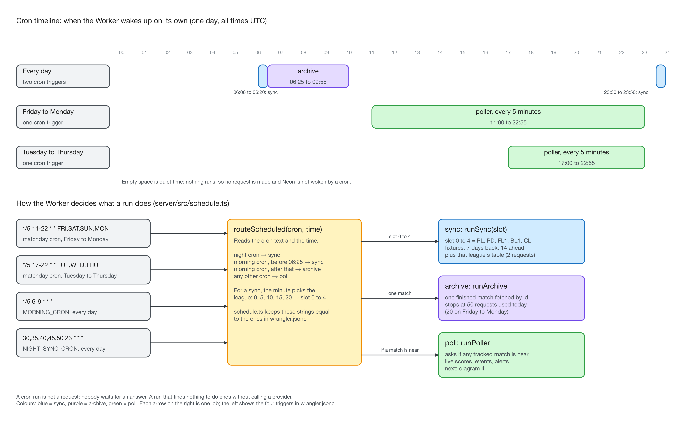

# Diagram 3: the cron timeline

Editable source: [03-cron-timeline.excalidraw](03-cron-timeline.excalidraw). The triggers are in [wrangler.jsonc](../../server/wrangler.jsonc), the picking logic is [schedule.ts](../../server/src/schedule.ts), and the entry point that receives a run is `scheduled()` in [index.ts](../../server/src/index.ts). Diagram 2 covered the other way into the Worker, a request from the app: [the request path](02-request-path.md).

## 1. The idea in one paragraph

Most of what ScorePulse does is not an answer to the app. Scores have to be fetched, tables copied and alerts sent while nobody has the app open. Nothing on the internet will wake ScorePulse when a goal is scored (neither data provider offers a push for live events that the project could confirm, see [ADR 0016](../adr/0016-poll-schedule-and-request-budget.md)), so the Worker **asks on a timer**. That timer is a **cron**, and this diagram shows when it fires and what each firing does.

## 2. Words you need

| Word | Meaning | Where you see it here |
| --- | --- | --- |
| **Cron** | A timer that runs something at set times. The name comes from an old Unix tool. | The four strings on the left of the lower half. |
| **Cron expression** | The five-field recipe for "when": `minute hour day-of-month month day-of-week`. `*` means every value, `*/5` means every 5th, `11-22` is a range, and `A,B` is a list. | `*/5 11-22 * * FRI,SAT,SUN,MON` reads: every 5 minutes, during hours 11 to 22, every day of the month, every month, on Friday to Monday. |
| **Trigger** | Cloudflare's word for one cron expression attached to a Worker. There are four. | The `crons` list in `wrangler.jsonc`. |
| **UTC** | The world's reference time zone, with no daylight saving. Every time here is UTC, and only the app turns it into the person's own time. | The hour numbers at the top. |
| **Poll / polling** | Asking again and again "has anything changed?", as opposed to being told. | The green bars. |
| **Beat** | One 5-minute tick of the poller. | "poller, every 5 minutes". |
| **Slot** | A number 0 to 4 saying which league a sync run does. | `slot` in `routeScheduled`. |
| **Quota** | How many requests a provider allows. API-Football's free plan allows **100 a day**; football-data.org allows 10 a minute. | The "stops at 50 requests" in the archive box. |
| **Early exit** | Finishing a run at once because there is nothing to do. | Section 5. |

## 3. How a cron run reaches the code

Each of the four triggers makes Cloudflare call `scheduled()` in `index.ts` and hand over the trigger's own text (`controller.cron`) and the time it fired. That is the bottom half of the diagram:

1. `routeScheduled(cron, time)` in `schedule.ts` looks at the cron text:
   - the **night** cron (`30,35,40,45,50 23 * * *`) always means a **sync**;
   - the **morning** cron (`*/5 6-9 * * *`) means a **sync** during 06:00 to 06:20 (the first five runs) and an **archive** run after that;
   - any other trigger is a matchday trigger, so it means a **poll**.
2. `scheduled()` then calls `runSync`, `runArchive` or `runPoller` with the database and the provider clients.

The comparison is against the exact text, so **the strings in `schedule.ts` and in `wrangler.jsonc` must stay identical**. If you edit one and not the other, the run silently falls into "any other cron", which is poll.

## 4. The three jobs

### Sync (06:00 to 06:20 and 23:30 to 23:50)

A sync copies the **fixture list and the league tables** from football-data.org into the database (the `fixtures` and `standings` tables from diagram 1). The cron fires **five times, five minutes apart, and each run does one league**. The `slot` picks it from this list in [football-data.ts](../../server/src/sync/football-data.ts):

| slot | 0 | 1 | 2 | 3 | 4 |
| --- | --- | --- | --- | --- | --- |
| league | PL (Premier League) | PD (La Liga) | FL1 (Ligue 1) | BL1 (Bundesliga) | CL (Champions League) |

For its league, a run asks football-data.org for the matches from 7 days ago to 14 days ahead, and for the table, which is 2 requests. The matches of the last week are there so that final scores get caught and so that the Results screen has something to show from the first run.

**Why one league per run?** The free Workers plan allows only 10 ms of CPU time per run ([ADR 0004](../adr/0004-stay-within-free-worker-cpu.md)). One league is a small enough job to fit; five leagues in one run might not. Spreading the work over five runs is how the project stays free.

It runs twice a day (morning and night), so most results are caught the same night, and any that finish after 23:50 are caught the next morning.

### Archive (06:25 to 09:55)

The quiet morning hours are used to fill in **match details for games that are already over** ([ADR 0017](../adr/0017-morning-archive.md)). Only matches somebody follows get a timeline, lineups and stats while they are live, so for every other finished match the archive fetches the details afterwards, **one match per run**, from API-Football by the match's id.

- It picks a favourite team's match first, then a match in a league where some user has a favourite, then the rest; the newest first within each group.
- It **stops at a line** so it does not eat the day's 100 requests: after 50 used, or after 20 used on Friday to Monday, when the live polling needs the most ([archive.ts](../../server/src/poller/archive.ts)). The weekdays counted are the UTC ones.
- It tries a given match at most 3 times and then leaves it, and once nothing is missing it makes **no request at all**.
- It stores the events **without sending alerts**, because the match is old news.

The consequence is that a match gets its details the morning *after* it is played, not at the final whistle. From 06:25 to 09:55 there are 43 runs a day, which is plenty to catch up on one night's matches.

### Poll (the green bars)

The poller is the live part: it fetches the scores and events of matches in play and sends alerts. Its triggers only fire in **matchday windows**, fixed in advance:

| Days | Window (UTC) | Last run |
| --- | --- | --- |
| Friday, Saturday, Sunday, Monday | 11:00 to 22:59 | 22:55 |
| Tuesday, Wednesday, Thursday | 17:00 to 22:59 | 22:55 |

The cron says `11-22`, which means hours 11 through 22 inclusive, so the last run of the day is 22:55 and the bar ends at 23:00. The expressions use day *names* because Cloudflare numbers weekdays differently from standard cron.

Outside these windows no cron fires, so nothing runs, and the database is not woken around the clock ([ADR 0010](../adr/0010-poller-early-exit.md)). The windows are fixed in UTC and ignore daylight saving.

## 5. Why a beat is cheap: the early exit

A fixed window does not mean every beat does work. Many beats have nothing live, and API-Football's free plan allows only **100 requests a day**, so the poller asks first. A run begins by reading the database (the quota used so far, the matches that might be due, and anything left from an earlier run) and decides whether a provider call is needed at all. A run that finds nothing to do ends there ([ADR 0010](../adr/0010-poller-early-exit.md)).

The budget arithmetic from [ADR 0016](../adr/0016-poll-schedule-and-request-budget.md) shows why this matters. At one request per 5-minute beat, a 2-hour match costs about 24 requests, a normal weeknight about 48, and a busy Saturday of overlapping matches about 110, which is more than the limit. So the poller also skips halftime, only polls from kickoff to full time, and stretches the interval to 10 minutes when the day's quota runs low. If the quota is spent, it falls back to football-data.org for scores only ([ADR 0015](../adr/0015-fall-back-to-football-data-scores-when-quota-is-exhausted.md)). The next diagram walks through that run step by step.

The sync does not use API-Football at all, which is why it has its own quota (football-data.org's) and does not take from the 100 a day.

## 6. Things that are easy to get wrong

- **Times are UTC.** A kickoff of 15:00 in your time zone may be 14:00 or 15:00 in UTC depending on the season. The windows do not move with the clocks.
- **The cron string lives in two places.** Change `wrangler.jsonc` and `schedule.ts` together.
- **A cron firing is not exact.** It fires on the minute, give or take, and the code accounts for that: a run just before the beat still counts as on it ([quota.ts](../../server/src/poller/quota.ts)).
- **Quiet is a feature.** If the timeline looks empty at night and in the early afternoon on a Tuesday, that is the design, not a bug.
- **Archive and poll share one budget.** Both spend from the same 100 requests a day, which is why the archive has a stop line.

## 7. Try it yourself

Wrangler, Cloudflare's command line tool, can fire a cron by hand while a Worker runs locally: start it with `wrangler dev --test-scheduled`, then request `/__scheduled?cron=<the cron text, URL-encoded>`. I haven't run this here, so check `wrangler dev --help` first. The log line `{"sync":"PL", ...}` that `run-sync.ts` prints is the easiest thing to look for.

Related: [diagram 2: the request path](02-request-path.md), [diagram 1: the database](01-database.md), [code map](../CODEMAP.md), [ADR index](../adr/INDEX.md)
