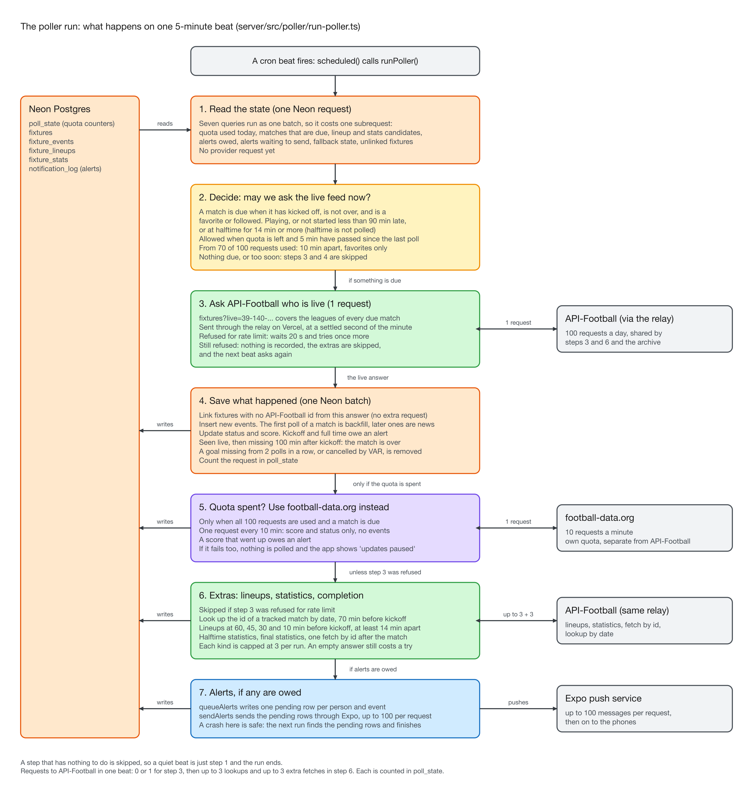

# Diagram 4: the poller run

Editable source: [04-poller-run.excalidraw](04-poller-run.excalidraw). The run is `runPoller()` in [run-poller.ts](../../server/src/poller/run-poller.ts); the steps call into the other files in `server/src/poller/`, named in the sections below. Diagram 3 showed when a beat fires: [the cron timeline](03-cron-timeline.md). This diagram is what happens inside one beat.

## 1. The idea in one paragraph

The poller is the heart of ScorePulse. Every 5 minutes during matchday hours it works out which matches somebody cares about, asks a data provider what happened, saves the changes, and tells the right people. The hard part is not any one step but the **limits**: API-Football's free plan allows only 100 requests a day and refuses requests that arrive too fast, the Worker gets only 10 ms of CPU per run, and the providers can fail at any moment. Almost every odd-looking line in these files exists to stay inside a limit or to survive a failure halfway.

## 2. Words you need

| Word | Meaning | Where you see it here |
| --- | --- | --- |
| **Live-tracked** (or just **tracked**) | A match the app must watch closely, because some user has a favourite team playing in it or follows it. A match nobody cares about is never polled. | `hasFavorite` and `hasFollow` in `run-poller.ts` (diagram 1 explains the two tables). |
| **Due** | A tracked match that has kicked off and is not over, so it is worth asking about now. | Step 2. |
| **Provider** | An outside service the app buys data from. Here: **API-Football** (live detail) and **football-data.org** (fixture list, and a backup for scores). | The grey boxes on the right. |
| **Relay** | A small forwarding server on Vercel. The Worker sends API-Football requests to it and it passes them on from a different internet address, because API-Football often refused requests from the Worker's own address. | Step 3, [relay.ts](../../relay/api/relay.ts). |
| **Quota** | How many requests you may make in a day. API-Football: 100, counted in UTC days. | `poll_state.requests_today`. |
| **Rate limit** | A different limit: how many requests in a minute. Going over it gets a refusal even when the day's quota is fine. | Step 3, [rate-limit.ts](../../server/src/poller/rate-limit.ts). |
| **Batch** | Several SQL statements sent to the database as one request, run in order as one transaction (all succeed or none do). Cheap, because a request costs CPU and a statement barely does. | Steps 1 and 4, `runBatch`. |
| **Subrequest** | One outgoing call a Worker makes while it runs. A run is limited to 50. | Why batches matter. |
| **Backfill** | Events that already existed when we first looked at a match. They are saved as history and **do not** trigger alerts. | Step 4, [ADR 0002](../adr/0002-follow-backfill.md). |
| **VAR** | The video referee. A goal can be cancelled after it was announced. | Step 4, [ADR 0009](../adr/0009-var-correction.md). |
| **Outbox** | A table of things owed, written first and acted on later, so a crash loses nothing. | `notification_log` in step 7. |
| **Fallback** | The backup source used when the main one cannot be. | Step 5, [ADR 0015](../adr/0015-fall-back-to-football-data-scores-when-quota-is-exhausted.md). |
| **Linking** | Giving a match the API-Football id it lacks. The fixture list comes from football-data.org with only that provider's ids; the live feed speaks API-Football's. | Step 4 and step 6, [link.ts](../../server/src/poller/link.ts). |

## 3. The steps

### Step 1: read the state, in one request

The run starts by reading everything it needs from Neon in **one batch of seven queries**: how much quota is used, which matches are due, which might need lineups or statistics, whether any alerts are owed, whether any are waiting to send, the fallback's state, and which matches lack an API-Football id. A quiet beat costs only this read.

### Step 2: may we ask the live feed now?

`planPoll()` in [quota.ts](../../server/src/poller/quota.ts) answers with plain arithmetic:

- Is there quota left (fewer than 100 used today)?
- Have enough minutes passed since the last poll? The interval is 5 minutes normally, and **10 minutes once 70 of the 100 are used**. A beat that arrives 30 seconds early still counts, because cron is not exact.
- At 70 or more used it also keeps **favourites only**: a match that is merely followed pauses until the quota recovers ([ADR 0013](../adr/0013-favorites-keep-polling-when-quota-is-low.md)).

The list of **due** matches (`dueFixturesQuery`) is every tracked match that kicked off within the last 4 hours and is:

- in play (`1H`, `2H`, `ET`, `BT`, `P`, `LIVE`), or
- still marked not started (`NS`) but under 90 minutes past kickoff, because the poll that would have said "it started" may have been missed, or
- at halftime (`HT`) for 14 minutes or more. **Halftime is deliberately not polled**, since nothing happens in it and requests are scarce.

If nothing is due, or it is too soon, steps 3 and 4 are skipped.

**A note on ADR 0010.** That ADR describes the early exit as one query asking whether anything is in play or due within 30 minutes. The code does not return early at that point. Instead, *every step skips itself when it has nothing to do*, and step 1's read is always made. The 30-minute lookahead survives only in one place: the list of matches that might need a link (step 4).

### Step 3: ask API-Football who is live (1 request)

A single request covers every due match: `fixtures?live=39-140` asks for the live matches of the leagues with those ids (39 is the Premier League, 140 La Liga). One league is sent twice (`39-39`) because the API rejects a single id with a `200` and an error ([api-football.ts](../../server/src/poller/api-football.ts)).

How the request is sent is where most of the care goes:

- **Through the relay.** The Worker's `API_FOOTBALL_BASE_URL` points at the Vercel relay. If the relay does not answer (down, misdeployed, over its own limits), the Worker logs a warning and asks API-Football directly. The relay marks its answers with an `x-relay` header, so a reply without it is known not to be the relay's.
- **A settled second.** The first request of a run waits until about the 3rd second of a minute. The cron fires at about :58, and API-Football's refusals clustered around :58 and :59.
- **Spacing.** Later requests in the same run are at least a second apart.
- **A refusal is not a failure.** API-Football refuses over-fast requests with a `200` whose body says `errors.rateLimit` (sometimes a real `429`). The code turns both into one error, `RateLimited`. It waits 20 seconds and tries **once** more. If that is refused as well, nothing is recorded (nothing was asked, so no quota was spent and no try was used), step 6 is skipped, and the next beat starts over.
- **Every answer is logged** with how many requests are left for the day and for the minute, refused ones included. That is how you can tell whether refused requests count against the 100.

### Step 4: save what happened, in one batch

[handle-poll.ts](../../server/src/poller/handle-poll.ts) matches the answer's matches to the due fixtures by their API-Football id and then writes everything in **one batch**, so it is one transaction:

1. **Linking.** Fixtures that had no API-Football id are matched from this answer, using the league, both team ids and the scheduled kickoff. Only an exact, unambiguous match is linked; the rest are logged and left alone. It costs no extra request.
2. **Events.** New events (goals, cards, substitutions) are inserted. `onConflictDoNothing` plus the composite unique key from diagram 1 make this safe to repeat. An event found on the **first poll** of a match is backfill (`alert_state = 'none'`); an event found later is news (`alert_state = 'due'`).
3. **Status and score.** If either changed, the row is updated. A change from not started to playing sets `kickoff_alert_due`, and a change to finished sets `full_time_alert_due`, **in the same statement**, so a crash cannot lose the alert. A kickoff alert is only for a match first seen within 10 minutes of the start.
4. **Match over.** `live=` stops listing a match at full time. A match that was seen live and is absent 100 minutes after kickoff is marked `FT` by the code.
5. **Seen.** `last_polled_at` and the current `minute` are written for every match the poll covered, even a quiet one.
6. **The request count** goes into `poll_state` in the same batch.

A second small batch then deals with **disappearing goals** ([ADR 0009](../adr/0009-var-correction.md)). A goal that was stored but is missing from the answer gets one strike (`missing_polls + 1`). Two strikes in a row, or a VAR event that names the same goal, mark it removed (`removed_at`). If its alert had already gone out (`alert_state = 'issued'`), a correction is owed (`correction_due`). One twist: an answer with an *empty* events list counts as nothing, not as every goal vanishing, because the API sometimes just returns nothing.

### Step 5: the fallback when the quota is spent

When all 100 requests are used and some match is due, step 3 cannot run. So `applyFallbackScores` in [fallback.ts](../../server/src/poller/fallback.ts) asks football-data.org for the score and status of everything live in the five leagues, **one request every 10 minutes**. It has no events, so there is no timeline; it only moves the score and status, and a score that went up owes a "score" alert. It keeps its own counters in `poll_state` under the id `football-data`.

It also keeps a count in `uncovered_goals` of goals it announced that have no event rows yet. When API-Football comes back and its timeline brings those goals as new events, that many are not alerted a second time. If football-data.org fails too, nothing is polled and the app shows "updates paused".

### Step 6: the extras (lineups, statistics, completion)

After the live poll, the run spends what is left of the day's quota on extra details, **but never when step 3 was refused**. The two selection functions are in [extras.ts](../../server/src/poller/extras.ts). Each is capped at 3 requests per run (`MAX_EXTRA_PER_RUN`), so a busy beat cannot spend a large part of the day at once:

- **Id lookups.** A tracked match still without an id is looked up by date, 70 minutes before kickoff, so the id is there when the first lineups try is due. One request covers every such match that day. At most 2 failed lookups per match.
- **Lineups.** Tried at 60, 45, 30 and then 10 minutes before kickoff, each at least 14 minutes after the one before. An empty answer ("not announced yet") is expected, so it is logged as a warning, but it still costs a try.
- **Completion.** Once a match is over, one fetch by id fills in whatever the last poll missed. A goal found that way is news only if the match ended recently, and is stored silently otherwise.
- **Statistics.** Halftime statistics, and final ones if the completion fetch did not bring them. Each at most 3 tries per phase.

When the day's quota is low (70 or more used), only the first lineups try of a favourite's match is made, and statistics wait for a better day. If a lineups request, a statistics request or a lookup is refused for rate limit, the run stops there.

Every run that has candidates logs one line, `extras: candidates [...], jobs [...]`, saying what it decided and why. Each candidate reads `fixture:status:apiId:lineups:tries`, where `L` means the lineups are saved and `-` means not yet.

### Step 7: alerts

If anything is owed, `deliverAlerts` does two things in order: `queueAlerts` writes one `pending` row in `notification_log` per person and event, and `sendAlerts` sends every pending row through Expo, up to 100 messages per request. The next diagram goes through that in detail. If the run is cut off between the two, the next run finds the pending rows and carries on, because step 1 checks for them.

## 4. Four typical beats

| Situation | What the run does | Cost |
| --- | --- | --- |
| **Nothing is happening** (a Tuesday evening, nobody follows anything in play) | Step 1 reads, finds nothing due and nothing owed. | 1 Neon request, 0 provider requests |
| **A normal live beat** | Steps 1 to 4: one request to API-Football, one batch of writes. Maybe a lineups fetch in step 6. Alerts if a goal was scored. | 1 or more provider requests |
| **Quota getting low** (70 or more used) | Interval 10 minutes, favourites only, lineups only for a favourite's first try, no statistics. | Fewer requests, slower updates |
| **Quota spent** | Step 3 is skipped; step 5 asks football-data.org every 10 minutes. | 0 requests to API-Football |

## 5. Following one goal through the run

A goal is scored in a followed match at 15:42 UTC.

1. The 15:45 beat reads the state (step 1). The match is in play and followed, so it is due; quota and timing allow a poll (step 2).
2. Step 3 asks API-Football. The answer lists the match with a new event "Normal Goal" and a score of 1-0.
3. Step 4 inserts the event with `alert_state = 'due'` (this is not the first poll, so it is news), updates the score, and records the request, all in one batch.
4. Step 7 sees an alert is owed. `queueAlerts` writes a `pending` row for each recipient, sets the event to `issued`, and `sendAlerts` pushes to their phones.
5. Ten minutes later VAR cancels the goal. The next poll sees a VAR event naming it, step 4's second batch sets `removed_at` and `correction_due`, and a correction alert goes out through the same path.

## 6. Things worth knowing

- **Two limits, not one.** The *quota* (100 a day) and the *rate limit* (per minute) are different. A refusal for the rate limit does not spend quota; the poller records only requests that were really answered.
- **Why so many "attempts" counters** (diagram 1). Each request that returns nothing still costs quota, so the code counts tries and stops after 2 or 3 instead of asking all day.
- **Everything is a batch of statements.** A run does few Neon requests on purpose. In tests the same code runs against PGlite, an in-memory Postgres, using the same `batch` interface.
- **A match with no API-Football id can't be polled.** It can't be matched to the live answer, so it waits for step 4's link or step 6's lookup. A log line `fixtures not linked to a live match` is the sign.
- **Changing the numbers.** The intervals and the 70 and 100 figures are constants in `quota.ts`; the lineup minutes are in `extras.ts`; the status codes are in [status.ts](../../server/src/poller/status.ts). Change them there and update the ADRs that quote them.
- **Reading the logs.** Observability is switched on for the Worker in `wrangler.jsonc`, and `wrangler tail` streams the lines. The ones to look for: `API-Football ... left today`, `relay did not answer`, `extras: candidates`, `fixtures not linked`.

Related: [diagram 3: the cron timeline](03-cron-timeline.md), [diagram 1: the database](01-database.md), [code map](../CODEMAP.md), [ADR 0001](../adr/0001-demand-driven-polling.md), [ADR 0016](../adr/0016-poll-schedule-and-request-budget.md), [glossary](../../GLOSSARY.md)
