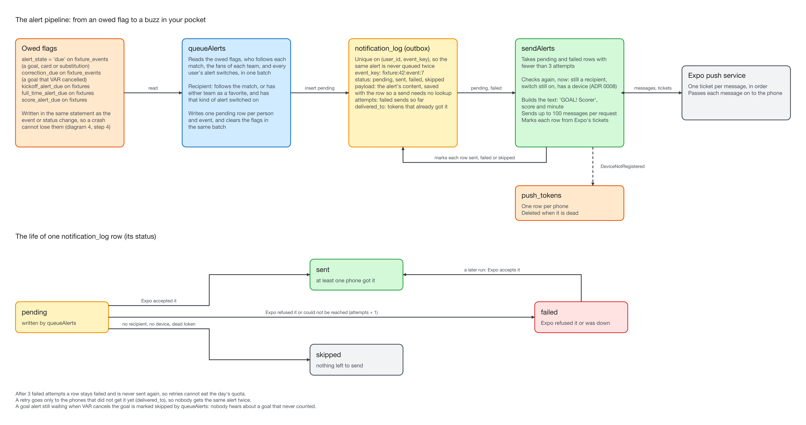

# Diagram 5: the alert pipeline

Editable source: [05-alert-pipeline.excalidraw](05-alert-pipeline.excalidraw). The two stages are [queue-alerts.ts](../../server/src/poller/queue-alerts.ts) and [send-alerts.ts](../../server/src/poller/send-alerts.ts), joined by `deliverAlerts` in [alerts.ts](../../server/src/poller/alerts.ts). This is step 7 of the poller run in diagram 4: [the poller run](04-poller-run.md).

## 1. The idea in one paragraph

When something worth telling people about happens (a goal, a card, kickoff), the poller does not send a notification at once. It first writes down that an alert is **owed**. A second step turns each owed alert into one row per person in a table, and a third step sends those rows and records what happened. Splitting it into three steps with a table in the middle means a crash at any moment loses nothing: whatever was not finished is still written down, and the next run carries on. The only cost is that a crash can occasionally mean an alert arrives late, or very rarely twice. The project chose that over ever missing one.

## 2. Words you need

| Word | Meaning | Where you see it here |
| --- | --- | --- |
| **Push notification** | A message that appears on a phone even when the app is closed. | The end of the pipeline. |
| **Expo Push** | A service run by Expo that accepts notifications for apps built with Expo and passes them on to the phone. This app is Android-only, so the last hop is Google's Firebase Cloud Messaging (FCM). | The grey box on the right. |
| **Push token** | An address for one phone, such as `ExponentPushToken[...]`. The app registers it with the server (`PUT /devices`) and it is stored in `push_tokens`. | `push_tokens`, see diagram 1. |
| **Ticket** | Expo's receipt for one message: `ok`, or an error. Expo returns one per message, in the same order. | Step 3. |
| **Payload** | The content of an alert: who scored, the score, the minute, the team names. | `notification_log.payload`. |
| **Outbox** | A table where "messages I still owe" are written first and sent later. | `notification_log`. |
| **Fan-out** | One event becoming many messages, one per person. | One goal, many rows. |
| **Recipient** | A person who should get a given alert: they follow that match, or have either team as a favourite, and have that *kind* of alert switched on. | `recipientsOf` in `queueAlerts`. |
| **Idempotent** | Safe to do twice: the second time changes nothing. | The unique key plus `onConflictDoNothing`. |
| **At-least-once delivery** | A promise that a message is sent one or more times, never zero. The alternative, "at most once", can lose messages. ScorePulse chooses at-least-once. | The crash note in section 5. |
| **State machine** | Something that is always in exactly one of a few states and moves between them by fixed rules. | The lower half of the diagram. |

## 3. Stage 1: owed flags (the first box)

The poller records "an alert is owed" as a flag on a row, written **in the same statement** as the thing that caused it. That is what makes it crash-safe: either the event and its flag are both saved, or neither is.

| Flag | Written when | Becomes |
| --- | --- | --- |
| `fixture_events.alert_state = 'due'` | A new goal, card or substitution is stored after the match's first poll | A `goal`, `card` or `substitution` alert |
| `fixture_events.correction_due` | A goal whose alert was already issued is cancelled | A `goal_removed` alert (the correction) |
| `fixtures.kickoff_alert_due` | The status changes from not started to playing, within 10 minutes of the start | A `kickoff` alert |
| `fixtures.full_time_alert_due` | The status changes from playing to finished | A `full_time` alert |
| `fixtures.score_alert_due` | The score went up while only football-data.org was answering | A `score` alert (no scorer or minute) |

Events found on a match's **first poll** are history, so they get `alert_state = 'none'` and never fire ([ADR 0002](../adr/0002-follow-backfill.md)). Without that, following a match in the 70th minute would send you every goal so far.

## 4. Stage 2: queueAlerts (the second box)

`queueAlerts` runs at the start of `deliverAlerts` and does this in one read batch and one write batch.

**Read** (one batch of queries): the owed events, the goals already standing in each of those matches, who follows each match, which users have a team in it, the team names, and **every user's alert switches** (cheap, because the group is 5 to 10 people, [ADR 0005](../adr/0005-target-five-to-ten-users.md)).

**Work out recipients.** For each owed alert, the people are the union of followers and fans, kept only if the matching switch is on. The mapping lives in [settings.ts](../../server/src/poller/settings.ts):

| Alert kind | Switch it follows | Default |
| --- | --- | --- |
| `goal`, `score`, `goal_removed` | Goals | on |
| `card` | Cards | off |
| `substitution` | Substitutions | off |
| `kickoff` | Kickoff | off |
| `full_time` | Full time | on |

A cancellation and a score-only alert follow the goals switch, so someone who turned goals off never gets a "goal cancelled" for a goal they were not told about.

**Build the payload.** A goal alert carries the score *as of that goal*, counted from the stored goals in order, not the match's current score. So if two goals arrive in one poll, each alert shows its own score. It also carries the scorer, the minute (`67'`, or `90+3'`) and both team names.

**Write** in one batch: the new rows go into `notification_log` as `pending` (`INSERT ... ON CONFLICT DO NOTHING`), and the flags are cleared (`alert_state = 'issued'`, `correction_due = false`, `kickoff_alert_due = false` and so on). Because the rows and the cleared flags are in the same batch, they happen together or not at all.

- **If the run dies before that batch**, the flags are still set, and the next run queues them. Late, never lost.
- **If the batch runs twice**, the unique key on (`user_id`, `event_key`) stops a second copy. The `event_key` identifies the event: `fixture:42:event:7` for a goal, the same with `:removed` for its correction, `fixture:42:kickoff`, `fixture:42:fulltime`, `fixture:42:score:2-1`.

**Two special cases:**

- **A correction** is sent only to people who were actually told about the goal (their row is `sent`) and who are still recipients. If the goal alert is still `pending` or `failed` when VAR cancels it, that row is simply marked `skipped`, so nobody hears about a goal that never counted ([ADR 0009](../adr/0009-var-correction.md)).
- **Goals already announced by a score-only alert** (`uncovered_goals`, from the football-data.org fallback in diagram 4) are counted off against the oldest new goal events, so the same goal is not announced a second time when API-Football's timeline arrives.

## 5. Stage 3: sendAlerts (the fourth box)

**Which rows.** `pending` or `failed` rows with fewer than 3 attempts and a payload (`MAX_SEND_TRIES = 3`). The poller's first read in diagram 4 counts such rows, so a quiet run does not even call `sendAlerts`.

**Check again, now.** This is the rule from [ADR 0008](../adr/0008-push-recipient-rules.md): *recipients are resolved at send time*. Between queueing and sending, a person may have unfollowed the match, removed a favourite, switched the alert off, signed out, or uninstalled the app. So for each row `sendAlerts` re-reads whether they still follow the match or have a team in it, whether the switch is still on, and which phones they have. A person who no longer qualifies has their row marked `skipped`.

**Which phones.** Every token of that user that is *not already in `delivered_to`*. A person with two phones gets two notifications for each event, by design. After a partial failure, a retry reaches only the phone that missed out.

**Build the message.** `alertText` makes the title and body, for example `GOAL! Haaland` with `Man City 2-1 Arsenal · 67'`, or `Goal cancelled` with `... · score corrected after VAR`.

**Send.** In chunks of 100, because Expo accepts up to 100 messages per request ([expo.ts](../../server/src/poller/expo.ts)). Expo answers with one ticket per message, in order.

**Read the tickets and record the result** in one batch:

| Ticket | What happens |
| --- | --- |
| `ok` | The token goes into `delivered_to`; the row becomes `sent`. |
| error `DeviceNotRegistered` | The phone no longer exists (app uninstalled). **That token is deleted from `push_tokens`**, so it is never tried again. |
| any other error, or Expo could not be reached at all | The row becomes `failed` and `attempts` goes up by one. |
| nothing at all was delivered and nothing failed | The row becomes `skipped` (this is also where a dead token ends up). |

**If the run dies** between sending and recording, the next run sends again. That is the rare duplicate, preferred to a missed alert, and the code says so in a comment.

## 6. The life of a row (the lower half)

A `notification_log` row is always in exactly one of four states:

- **pending**: written by `queueAlerts`, waiting to go.
- **sent**: at least one phone accepted it. Final.
- **skipped**: there was nothing left to send, because the person is no longer a recipient, has no phone, switched it off, or the only phone was dead. Final.
- **failed**: Expo refused it or was down. `sendAlerts` tries it again on a later run, until it has failed 3 times. After that it stays `failed` and is never sent again, so retries cannot eat the day's budget of requests.

## 7. Following one goal

A goal is scored in a match followed by Ana (one phone), Ben (two phones) and Cai (goals switched off).

1. The poller stores the goal with `alert_state = 'due'` (diagram 4, step 4) and, seeing an alert is owed, calls `deliverAlerts`.
2. `queueAlerts` finds the goal. Cai is dropped because the goal switch is off. It writes two `pending` rows, Ana's and Ben's, with `event_key = fixture:42:event:7` and the payload "Man City 2-1 Arsenal · 67'". The goal's `alert_state` becomes `issued`.
3. `sendAlerts` picks up both rows, finds Ana's one token and Ben's two, and sends three messages in one Expo request.
4. Expo returns three `ok` tickets. Both rows become `sent`, with the tokens in `delivered_to`.
5. Suppose instead Ben's second phone had been uninstalled: that ticket says `DeviceNotRegistered`, its token is deleted, and Ben's row is still `sent` because his other phone got it.
6. Ten minutes later VAR cancels the goal. The poller sets `correction_due`. `queueAlerts` sees Ana's and Ben's rows are `sent`, so each gets a new row with the key `fixture:42:event:7:removed`, and `sendAlerts` sends "Goal cancelled".

## 8. Things worth knowing

- **Two phones, two notifications.** That is the intended behaviour, not a bug.
- **The table keeps history.** `sent` rows are not deleted. That is how a correction knows who was told, and how you can see what was sent.
- **A switch takes effect at send time.** Turning a switch off after an alert is queued but before it is sent stops that alert.
- **Look at the table.** In Neon's SQL editor, `select status, count(*) from notification_log group by status;` shows the mix, and `select * from notification_log where status = 'failed';` shows what Expo refused. A pile of `failed` rows means Expo was unreachable or the tokens are wrong.
- **The pipeline only helps if tokens exist.** Everything above assumes `push_tokens` has a row for the person. [The Android push spec](../specs/android-push-notifications.md) records a case where it had none, because the installed app had no Firebase config and so could not get a token, and lists the two Firebase files that fix it.

Related: [diagram 4: the poller run](04-poller-run.md), [diagram 1: the database](01-database.md), [code map](../CODEMAP.md), [ADR 0008](../adr/0008-push-recipient-rules.md), [ADR 0009](../adr/0009-var-correction.md), [glossary](../../GLOSSARY.md)
