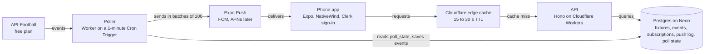

# ScorePulse: Project Plan

Last updated: 5 October 2026

## Overview

ScorePulse is a mobile sports app that starts with football and may add F1, cricket and other sports later. Version 1 is football only. It gives fans live scores, a catch-up match timeline and push alerts for the teams and matches they follow. Version 1 covers five competitions: La Liga, Premier League, Ligue 1, Bundesliga and the Champions League. It is a solo-built side project that must run at zero cost until it earns money, so every decision favors free tiers, low compute and fast shipping. Version 1 targets Android; iOS follows only if the app earns enough to cover Apple's yearly fee.

**Version 1 features**

- Sign-in and a profile with up to 3 favorite teams
- Fixtures, results and standings by league
- A match screen with a timeline of goals, cards, substitutions and VAR, plus lineups and stats
- Push alerts: automatic for favorite teams, and follow-a-match until full time
- News and transfers arrive in a later phase

**MVP success criteria**

- A new user can sign in, pick teams and open any match from today
- A goal in a followed match reaches the phone with the scorer's name, once only, within one polling interval
- The server stays inside the daily API request budget on a normal matchday
- Running cost stays at zero: no paid service is needed to run the MVP

## Locked decisions

The stack is TypeScript end to end, with two folders in one repo (`/app` and `/server`) and no monorepo tooling. Hono's typed client lets the app import the server's route types (`import type { AppType }` only), which gives type safety without workspaces. If type resolution across folders becomes painful, fall back to a small shared types folder or a light npm workspace.

| Area | Choice | Why |
| --- | --- | --- |
| Mobile app | Expo, Expo Router, NativeWind (pin versions) | Fast builds, one codebase, Tailwind-style styling |
| Platform | Android first; iOS deferred | Google Play is a $25 one-time fee; iOS push and the App Store need $99 a year |
| Builds | EAS free plan (15 Android builds a month), with local builds (`eas build --local` or Android Studio) as the fallback | The free cap is enough for a solo developer; local builds remove it entirely |
| Server state | TanStack Query | Caching and refetching of match data |
| Backend | Hono on Cloudflare Workers | Free tier, no server to keep alive, Hono runs natively on Workers |
| Edge cache | Cloudflare Cache API | Live endpoints cached 15 to 30 seconds, so database reads do not grow with users |
| Database | Neon Postgres with Drizzle (pooled connection for the Workers, direct connection for migrations) | Free serverless Postgres (1 GB and 100 CU-hours a month per project), typed queries |
| Scheduling | Cloudflare Cron Triggers plus a `poll_state` row in Postgres | No always-on process, no Redis, and the database sleeps when nothing is live |
| Auth | Clerk | Fastest setup, free Hobby tier (50,000 monthly retained users; only users who return are counted). Sign in with Apple is required on iOS if Google login is offered |
| Push | Expo Push Service | Free; wraps FCM (and APNs later); needs token storage, receipts and dedupe |
| Monitoring | Sentry (app and server) | Free tier; Workers need no separate uptime monitor |
| Football data | API-Football, free plan | All endpoints on every plan; the $19 Pro plan is an optional upgrade, only if usage needs it |
| News | RSS feeds, headline plus link out | Avoids copying publisher content |

Free-tier limits were checked against the official pricing and docs pages on 5 October 2026 (Cloudflare Workers and Queues, Neon, Clerk, Expo, Sentry, Apple, Google Play). They change often, so re-check before launch. Not confirmed from an official page: API-Football's pricing page blocked automated fetching (the 100 and 7,500 requests a day figures come from secondary sources and our own test), Neon's minimum free compute size, and Expo Push being free of charge.

## Architecture

The app and the API never touch the football provider: one cron-triggered Worker calls API-Football on a timer, saves what changed to Postgres and sends the alerts.

Across all parts: Clerk signs users in, Sentry reports errors.

The poller is the only part that calls API-Football. The phone reads from our API through an edge cache, which reads from Postgres, so provider cost follows the number of live matches and database load does not follow the number of users.

## Data source findings

The free API-Football plan is enough to build and test the whole live pipeline, because live and same-day queries work; it is not enough for full coverage or heavy traffic. We tested it on 3 October 2026 with a real key; these are results, not documentation claims.

| Question | Result |
| --- | --- |
| Daily quota | 100 requests per day on the free plan; the API stops answering at the cap and never bills extra |
| Date window | `date` queries work only for yesterday, today and tomorrow (the error named 2026-10-02 to 2026-10-04) |
| Season window | `season` queries work only for 2022 to 2024; 2025 and 2026 return a plan error |
| Today's matches | `fixtures?date=YYYY-MM-DD` returned about 1,295 matches worldwide in one request (about 11 MB) |
| Live matches | `fixtures?live=all` returned 223 live matches with events included, in one request (about 4 MB) |
| League filter | `live=39-140-61-78-2` was accepted. It returned zero because none of those leagues played that day, so it is untested on a real matchday |
| One match in full | `fixtures?id=<id>` returns events, lineups, team statistics and player statistics in one call (about 730 KB) |
| Events | Goals (normal, penalty, own, missed penalty) with scorer and assist; yellow and red cards; substitutions numbered 1 to 5. No VAR events appeared in the sample |
| Event identity | Events carry no unique id, so dedupe uses a composite key |
| Tackles and commentary | Not available as timed events; tackles exist only as per-player totals |
| Update speed | Fixtures and events refresh every 15 seconds on the provider side |

League ids: La Liga is 140 (confirmed in the test). Premier League 39, Ligue 1 61, Bundesliga 78 and Champions League 2 are from memory and must be confirmed with `leagues?id=` in Phase 1.

**What the free plan means for the design**

- The 100 requests a day is a global budget, not a per-user one. 5 users and 5,000 users cost the same, so the real limit is coverage hours, not user count.
- Current-season standings and full-season schedules are blocked by the season window. Build and test the Phase 2 and 3 screens against 2024 data, and expect live and same-day data only for the current season.
- The 4 MB and 11 MB responses are too large for a poller to download every few minutes, and too large for a free Worker's CPU limit. The poller must use the league-filtered `live` call and fetch the full-day fixture list once.

**Daily request budget on the free plan (100 requests)**

- 1 request for the day's fixtures
- About 5 requests for standings, refreshed only after matches finish
- About 15 requests held back for lookups and development
- The remaining roughly 80 go to live polling, which is about three 2-hour match windows at a 5-minute interval

## Data model

The database has two groups of tables: ones mirrored from API-Football so the app never calls the provider directly, and ones that belong only to our app. Mirrored tables keep the provider's ids as keys, which makes upserts simple.

**Mirrored from API-Football**

| Table | Holds | Notes |
| --- | --- | --- |
| `leagues` | The five competitions and their seasons, plus a `sport` column (always `football` in v1) | Seeded once, rarely changes. The `sport` column avoids a table rename when more sports arrive |
| `teams` | Name, logo, venue, league links | Seeded once, refreshed weekly |
| `fixtures` | Kickoff, status, elapsed minute, score, home and away team | Refreshed hourly, and by the poller while live |
| `fixture_events` | Goals, cards, substitutions, VAR for each fixture | Unique on a composite key (below); a `removed_at` column marks events the provider later drops, such as a VAR-cancelled goal |
| `fixture_lineups` | Formation, starters, substitutes | Fetched when a match goes live |
| `standings` | League table rows | Refreshed after matches finish |
| `transfers` | Player moves | Added in the news and transfers phase |

The event dedupe key is fixture id, minute, extra minute, team id, player id, type and detail. The provider gives events no id of their own. Extra minute and player id are often NULL, and a normal Postgres unique constraint treats NULLs as distinct, which would let duplicates through. Declare the constraint as `UNIQUE NULLS NOT DISTINCT` (Postgres 15 and later, which Neon supports), or `COALESCE` the nullable columns into a computed key column.

**Owned by the app**

| Table | Holds | Notes |
| --- | --- | --- |
| `users` | Clerk user id, timezone, created date | Row created on first sign-in; deleted with the account, and kept in sync by a Clerk `user.deleted` webhook |
| `push_tokens` | Expo push token, platform, user id, last seen | One user can have several devices |
| `subscriptions` | User, type (`team` or `match`), team or fixture id, and per-event toggles for goals, cards, substitutions, kickoff and full time | The limit of 3 favorite teams is enforced in the API |
| `notification_log` | User, fixture, event key, status (`pending`, `sent`, `failed`), sent time, receipt status | Unique on user plus event key, so a retry never sends twice |
| `poll_state` | Last poll time, next due time, current interval, active fixture ids | Read by the cron handler every minute to decide whether a poll is due |
| `api_usage` | Date, requests used, requests remaining | Written from the provider's response headers; drives the quota guard |
| `news_items` | Title, source, link, published time, team tags | Added with the news phase |

Times are stored in UTC and shown in each user's timezone. Match subscriptions can be cleared automatically a day after the match ends.

## Live engine

The poller runs on a cron trigger every minute, reads `poll_state`, and exits immediately unless a poll is due. When one is due, it makes a single league-filtered `live` call that covers every followed league at once, so cost depends on how long matches run, not on how many users follow them or how many matches are on. A wall-clock timer is simpler and safer than one tied to match minutes, because stoppage time, delays and halftime make match minutes unreliable.

**Polling rules**

- The interval is a config value: about 5 minutes on the free plan, 30 to 60 seconds on a paid plan. Cron fires every minute, so sub-minute intervals need an upgrade path (several fetches inside one invocation, or a Durable Object alarm), which is out of scope for the MVP. The provider refreshes every 15 seconds, so polling faster than that has no use.
- Always make one league-filtered `live=39-140-61-78-2` call per poll, never one call per match.
- Polling is demand-driven. A poll happens only if at least one user follows a live match, or one of its teams is a favorite of at least one user. Unwatched matches, and matchdays nobody follows, cost nothing, and Neon can sleep.
- Polling pauses at halftime and ends only when the status is a final one (finished, after extra time, after penalties, abandoned), never after a fixed 90 minutes.
- Extra time and penalty shootouts are shown as their own sections of the timeline.
- All schedule state lives in Postgres (`poll_state`), so a Worker redeploy or failed invocation resumes where it stopped. Use an update-where-due step on the row so two overlapping invocations never poll twice.

**Free-tier limits to design around**

- CPU time is 10 ms per invocation on the free Workers plan, and that applies to cron-triggered runs as well as HTTP requests. Time spent waiting on the network or database does not count, but parsing JSON and building queries does. Only small, filtered responses are safe; never call `live=all`. Measure the poll handler's CPU time against a saved live response in Phase 1, and keep it lean (parse once, batch the inserts).
- Outbound subrequests are 50 per invocation, and each database query over HTTP counts as one. Expo Push accepts 100 notifications per request, so batch them. For a very large fan-out, hand the work to Cloudflare Queues (free: 10,000 operations a day, 24-hour retention).
- The free plan allows 5 Cron Triggers per account. This design needs one or two.

**Quota guard**

- After every call the poller records the remaining quota from the response headers into `api_usage`.
- About 20 requests a day are reserved for fixtures and standings.
- When the live budget runs low, the interval widens automatically, and the app shows "updates paused" instead of failing silently.

**Handling events**

- Each poll compares incoming events with stored ones using the composite key and inserts only new ones.
- Events that disappear from a later response are marked `removed_at`, not deleted, but only after they are missing for 2 or more consecutive polls. One thin response must not trigger a false cancellation or a flapping event.
- If an alert for a cancelled goal already went out, a correction notification is sent.
- If VAR changes a goal's scorer or minute, the composite key changes. Treat that as a correction of the old goal plus an updated goal, not as a second goal alert.
- The app's timeline groups events by minute bands for display. The groups are a display choice; storage is one `fixture_events` table.

**Replay simulator**

A development tool that feeds a recorded match, from seasons 2022 to 2024 or from a saved live response, into the same pipeline at accelerated speed. It lets us test goals, cards, VAR corrections, extra time and push alerts on demand, without waiting for real matches or spending quota.

## Notifications

Users get alerts in two ways, and both are rows in the same `subscriptions` table, which keeps the sending code to one path.

1. **Favorite teams, up to 3.** Whenever one of these teams plays, the user receives alerts automatically.
2. **Follow a match.** The user opens any match and taps follow; alerts for that match run until full time, then the subscription expires.

**Event toggles.** Each subscription has switches for kickoff, goals, cards, substitutions and full time. Defaults are goals and full time on, so new users are not flooded.

**Sending flow**

1. The poller inserts a new event into `fixture_events`.
2. It finds every user subscribed to that fixture or either team, whose toggle for that event type is on.
3. For each user it writes a `notification_log` row with status `pending`. The unique key on user plus event key makes a repeat poll harmless.
4. It sends the `pending` rows through the Expo Push Service in batches of 100, and marks each row `sent` or `failed`.
5. A retry job picks up rows left `pending` or `failed` (for example after a crash between steps 3 and 4), so an alert is never silently lost and the unique key still prevents duplicates.
6. A later job checks receipts and deletes tokens that report the device is no longer registered.

**Content.** A goal alert names the scorer, the minute and the new score, for example "34' Goal: Lewandowski (assist Raphinha). Barcelona 1-0 Real Madrid". A cancelled goal sends a short correction.

**Permission flow.** The app asks for notification permission after the user picks a first team, not at launch, because the request makes more sense once the user has seen what the alerts are for.

**Account deletion.** Deleting an account removes the `users` row, its tokens and its subscriptions, and also deletes the Clerk user. A Clerk `user.deleted` webhook keeps the two sides from drifting apart.

## Phases

The build runs in seven phases, in order, and each one ends with something that can be run and checked before the next begins.

| Phase | What happens | Gate: done when |
| --- | --- | --- |
| 1. Setup and spikes | Accounts, repo, hello-world end to end | App, API, Neon and Sentry connected |
| 2. Data foundation | Schema, provider adapter, hourly sync | Fixtures and standings sync hourly (standings tested on 2024 data) |
| 3. App core | Sign-in, favorites, league and match screens | Sign in, pick teams, open a match |
| 4. Live engine | Cron poller, event upserts, timeline, replay simulator | Replay match shows a live timeline |
| 5. Push notifications | Tokens, subscriptions, alerts, dedupe, retry, settings | Goal alert arrives once, on an Android phone |
| 6. News and transfers | RSS news feed and a transfers screen | News and transfers screens live |
| 7. Launch prep | Privacy policy, account deletion, beta, Google Play listing | Beta users and a store listing; the Pro plan and iOS are optional, only if usage or income justify them |

Phases 1 to 3 need no live matches. The replay simulator makes Phase 4 and Phase 5 testable on demand, and the free API plan is enough through launch. Upgrade to the $19 Pro plan only if real usage outgrows the coverage hours.

## Phase 1 checklist

Phase 1 is done when a signed-in user in the app calls the Cloudflare API, the API reads a row from Neon, and a deliberate error shows up in Sentry. These are the tasks in a sensible order.

**Housekeeping**

- [ ] Regenerate the API-Football key in the dashboard (the old one was pasted into a chat) and keep keys only in Worker secrets, never in the app
- [ ] Confirm league ids 39, 61, 78 and 2 with `leagues?id=`
- [ ] Run `live=39-140-61-78-2` once on a league matchday and check the response
- [ ] Re-check the free-tier limits, and confirm the unverified ones: Neon's minimum free compute size, Postgres version for `NULLS NOT DISTINCT`, and Expo Push pricing
- [ ] CPU spike: run the poll handler against a saved live response under `wrangler dev` and confirm it fits in 10 ms of CPU

**Accounts and projects**

- [ ] Create a Git repo with `/app` and `/server` folders
- [ ] Create a Neon project with a development database (note both strings: pooled for the Workers, direct for migrations)
- [ ] Create a Clerk application and note its keys
- [ ] Create a Cloudflare account and install Wrangler
- [ ] Create two Sentry projects, one for the app and one for the server

**Server**

- [ ] Hono app on Cloudflare Workers with a `/health` route
- [ ] Drizzle connected to Neon through the serverless driver, with a first migration for `users`
- [ ] Clerk token check on one protected route
- [ ] Deploy with Wrangler
- [ ] A cron trigger that logs once a minute (proves the scheduler works)
- [ ] Sentry wired in, with one test error

**App**

- [ ] Expo app with Expo Router and NativeWind, running on a real Android phone
- [ ] Clerk sign-in screen
- [ ] A screen that calls the protected route and shows the result
- [ ] Sentry wired in on the app side

Push notifications generally need a development build rather than Expo Go. That can wait until Phase 5. iOS builds and push need a paid Apple Developer account, so iOS is deferred until the app earns income.

## Risks and later ideas

The biggest risk is that the free API plan limits coverage hours, so the plan degrades gracefully ("updates paused") and treats the $19 Pro plan (7,500 requests a day) as an optional upgrade.

**Risks**

| Risk | Mitigation |
| --- | --- |
| Free quota of 100 requests a day runs out on a busy matchday | One filtered live call per poll, demand-driven polling, quota guard, adaptive interval, optional Pro plan |
| The five target leagues are untested on a real matchday | Run the league-filtered live call on the next league weekend, before building the alert flow on it |
| Duplicate or revised events (VAR) | `NULLS NOT DISTINCT` composite key, `removed_at` with a 2-poll grace period, correction handling, notification log with a unique key |
| Alert lost if the poller crashes mid-send | `notification_log` status column plus a retry job |
| Neon free-tier compute or storage limits (100 CU-hours a month and 1 GB per project; compute suspends after 5 idle minutes and this cannot be turned off) | Edge cache on live endpoints, demand-driven polling so the database can sleep, small tables. At an assumed 0.25 CU minimum, a database that never sleeps would use up the 100 CU-hours in about 16 days |
| Cloudflare free-tier CPU limit of 10 ms, which also applies to cron runs | Filtered responses only, lean handler, measure in Phase 1; fall back to a paid Workers plan if it cannot fit |
| Cloudflare subrequest limit of 50 per invocation | Batches of 100 pushes, Queues for large fan-out |
| Free-tier limits change | Re-check pricing pages in Phase 1 and before launch |
| Failed or overlapping cron invocations | Schedule state in Postgres with an update-where-due guard, Sentry alerts |
| Hono typed client resolving server types in the app | Type-only imports; fall back to a shared types folder or light workspace |
| Provider terms on commercial use | Read the API-Football terms before charging users or showing ads |
| App store review | Account deletion (including the Clerk user), privacy policy and a proper notification permission flow, planned before submission |
| News licensing | RSS headlines with links out only; no copied article text |

**Open questions**

- Are the Premier League, Ligue 1, Bundesliga and Champions League ids exactly 39, 61, 78 and 2?
- Which substitution field is the player coming on and which is the one going off? Check against a real lineup in Phase 2.
- Do VAR events appear for the five target leagues on the free plan?
- How should a VAR change to a goal's scorer be worded in the correction notification?

**Later ideas**

- AI-written commentary built from the stored events and stats, limited to what the data supports
- More sports (F1, cricket). Keep the football-only schema for now and put the provider behind one adapter interface in Phase 2. Do not build a generic event model until a second sport's real data is in hand, because cricket (overs, balls, innings) and F1 (positions, laps) have different shapes. Each sport will likely need its own provider and its own free-tier limits, so re-check the zero-cost plan per sport
- Before launch, check the ScorePulse name: app stores (including the similar "PulseScore"), domains, social handles and trademark databases
- Sportmonks commentary for text play-by-play on major leagues, subject to plan and league coverage
- Real-time updates over server-sent events or WebSockets instead of app polling
- Sub-minute polling through Durable Object alarms once on a paid plan
- iOS release once income covers the Apple Developer fee
- More leagues, club pages, player pages and a premium tier
